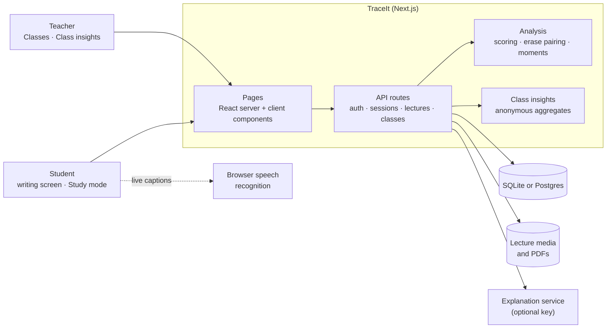

# TraceIt

**Your eraser is hiding the good stuff.**

**Live demo:** <your Render URL> · **Demo video:** <link>

TraceIt is a note-taking app for lectures that keeps what you erase. Erased ink stays on the page as faint
_ghost ink_, and every stroke is tied to the second of the lecture it was written in. TraceIt notices where
you slowed down, erased or rewrote, turns those spots into a short guided review, and shows teachers where
their whole class got stuck.

Our CalHacks 13.0 project, by Pranav Chowdary, Nagasai Kakani and Aasrith Mandava.

## Features

**Students**

- **Writing screen**: write along with a recorded lecture, or a live one with captions. Pen (Fine / Medium /
  Bold), eraser (Small / Large), undo, and **Show erased ink**.
- **Study mode**: after **Finish & review**, opens the most important moment first and steps through the
  rest. Each moment shows why it was flagged, your first try next to your second, what the lecture said at
  that point (**Play this part**), and a quick self-test in 10 languages. **Download PDF** exports the notes.
- **Moments**: **Fixed** (you corrected it), **Still fuzzy** (not resolved yet), **Aha moment**.
- **My progress**: fuzzy spots carry over between sessions and clear once you get them right.

**Teachers**

- **Classes**: create a class and share its join code; students join at `/join/<code>`.
- **Class insights**: an anonymous heatmap of where enrolled students slowed down or erased, plus the three
  moments most worth re-teaching. A slice is shown only when at least 3 students are in it.

Sign-in is email and password, as a student or a teacher. The landing page is `/welcome`.

## Architecture



1. The browser records each stroke with its lecture time, speed and pressure, and autosaves it.
2. On **Finish & review**, the analysis scores 10-second windows against the student's own pace, pairs each
   erase with the rewrite that followed, and classifies the moments.
3. Study mode loads the moments; explanations and self-tests come from the explanation service, and answers
   are checked on the server.
4. Class insights combines enrolled students' results without names, and hides any group under three.

## Quick start

Node 22+.

```bash
npm install
cp .env.local.example .env.local   # optional: add a GROQ_API_KEY for live explanations
npm run dev                        # http://localhost:3000
npm run seed:demo                  # optional: sample notes for "Maya"
npm run demo                       # demo mode (DEMO_MODE=1) on a production build
```

Everything works without keys: explanations fall back to built-in answers and read-aloud uses the browser's
voice. Data is stored in `data/traceit.db` (SQLite) unless `DATABASE_URL` is set.

## Demo mode

`DEMO_MODE=1` turns the app into a public demo:

- `/signin` shows **Try the demo** (student "Maya") and **Try the teacher view** (class "Calculus I", join
  code `MAYA2026`).
- Sign-up, class creation, uploads and live lectures are turned off.
- Explanations come from bundled, hand-checked answers, so no keys are needed.
- Sample data resets every 30 minutes. Real accounts are never touched.

The bundled lecture in `public/demo/` is a generated six-minute talk on the chain rule.

## Configuration

All variables are optional; `.env.local.example` documents every one.

| Variable | Purpose |
| --- | --- |
| `GROQ_API_KEY` | Live explanations, self-tests and transcription (OpenAI, Gemini and xAI keys also work) |
| `ELEVENLABS_API_KEY` | Natural read-aloud voice |
| `DEMO_MODE=1` | Public demo mode |
| `DATABASE_URL` | Use Postgres instead of SQLite |
| `TRACEIT_DATA_DIR` | Where the database and uploads live (default `data/`) |
| `TRACEIT_SESSION_DAYS` | How long a sign-in lasts (default 30) |

Passwords are hashed with scrypt and sign-in sessions are stored as hashed random tokens, so no auth secret
is needed. Old `INKLING_*` variable names are still accepted.

## Tests

```bash
npx tsc --noEmit && npm run lint
npm test                            # unit and integration tests (SQLite and embedded Postgres)
npm run test:e2e                    # Playwright end-to-end tests
TRACEIT_TEST_PG=1 npm run test:e2e  # the same suite on Postgres
```

Playwright starts its own servers on ports **3100** and **3101**, so those must be free.

## Deploy

**Render**

1. **New → Web Service**, connect `Aasrith-Mandava/traceit` (branch `main`), runtime **Docker**.
2. Environment: `DEMO_MODE=1`, `TRACEIT_DATA_DIR=/data`.
3. Health check path: `/api/health`.

Every push to `main` redeploys. On the free plan the disk resets on restart, which is fine for demo mode
because the sample data is re-seeded on start. For Railway, see [`docs/railway.md`](docs/railway.md).

## Project structure

```text
app/(marketing)/   landing page
app/(product)/     the app: sign in, My notes, writing screen, Study mode, My progress, classes, Class insights
app/api/           API routes
components/        UI components
lib/               analysis, storage (SQLite / Postgres), auth, explanations, demo seed and reset
public/demo/       bundled demo lecture
e2e/, lib/__tests__/   tests
docs/              deployment guides and write-ups
```
